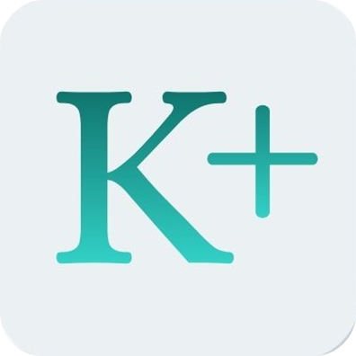
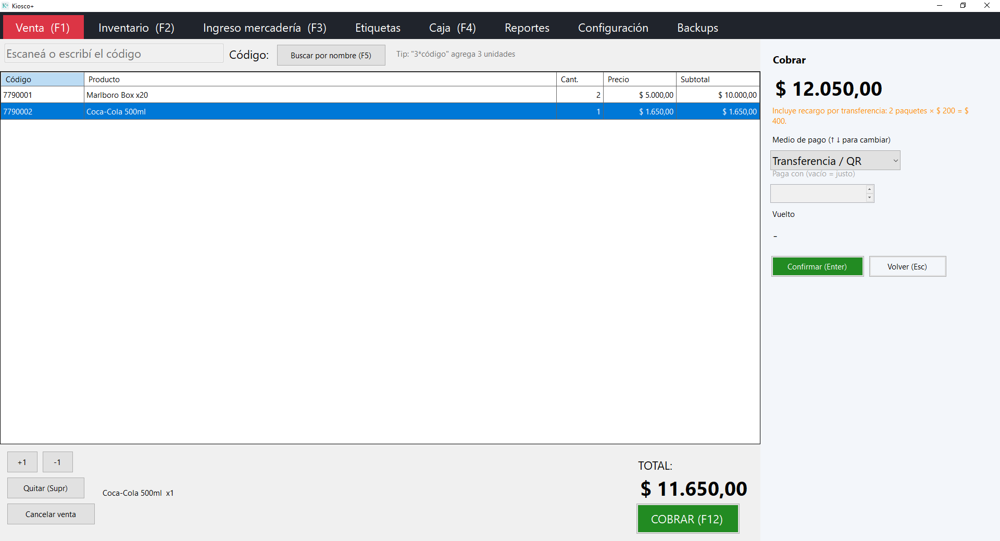
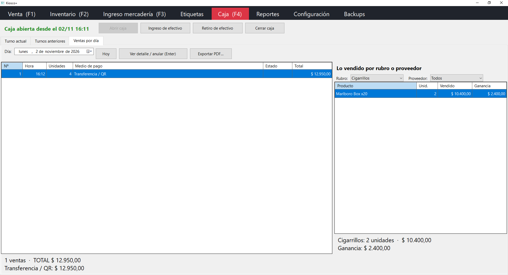

<p align="center">
  
</p>

<h1 align="center">Kiosco+</h1>

<p align="center">
  Sistema de punto de venta para kioscos: ventas con lector de código de barras, inventario, caja y reportes.<br>
  Hecho en <b>C# / .NET 10</b>, en uso real en un kiosco familiar.
</p>

---

## Qué es

Kiosco+ es una aplicación de escritorio para Windows que reemplaza el cuaderno y la calculadora de un kiosco.
Se diseñó junto a sus usuarios (personas de más de 50 años, sin experiencia con sistemas): todo pasa en una
sola ventana, se maneja con el lector de códigos y unas pocas teclas, y cada acción explica qué hizo.



## Funcionalidades

- **Venta con lector de códigos de barras**, búsqueda por nombre y alta de productos nuevos sin salir de la venta.
- **Cobro con varios medios** (efectivo, débito, crédito, transferencia/QR) y cálculo de vuelto.
- **Reglas de negocio configurables**: recargo por paquete de cigarrillos al pagar por transferencia y monto mínimo para transferir.
- **Productos con precio al vender** (por peso) y **unidades sueltas** que abren paquetes automáticamente.
- **Inventario** con categorías, proveedores, alertas de stock bajo y **aumentos masivos de precios** con vista previa.
- **Importación desde otro programa** (Excel .xlsx o CSV): detecta las columnas por sus títulos, muestra fila por fila qué va a pasar y guarda todo en una sola transacción, con backup previo.
- **Caja por turnos**: apertura, ingresos y retiros, cierre con diferencia de efectivo y anulación de ventas.
- **Reportes** de ventas y ganancia por período, y lo vendido por rubro o proveedor.
- **Impresión**: tickets en impresoras térmicas y **etiquetas de precio** en hojas A4; exportación de ventas a **PDF**.
- **Backups automáticos** diarios (con carpeta extra en la nube) y restauración desde el programa.
- **Tema claro y oscuro**.



## Tecnología

| | |
|---|---|
| Lenguaje y plataforma | C# 14, .NET 10, Windows Forms |
| Datos | SQLite (Microsoft.Data.Sqlite) con migraciones versionadas |
| PDF | QuestPDF |
| Inyección de dependencias | Microsoft.Extensions.DependencyInjection |
| Tests | xUnit: **240+ tests** unitarios y de integración contra SQLite real |
| Distribución | Ejecutable único autocontenido (no requiere instalar .NET) |

## Arquitectura

Solución en capas, con las reglas del negocio aisladas de la interfaz y de la base de datos:

```
Dominio      entidades, reglas y servicios (sin dependencias externas)
  ↑
Datos        repositorios SQLite, migraciones y backups
Reportes     PDF de ventas y reportes
  ↑
Aplicación   WinForms: una ventana con secciones y paneles laterales (sin ventanas emergentes)
```

Algunas decisiones de diseño:

- **Orientación a objetos con entidades que se protegen solas**: los datos se cambian solo a través de métodos que validan las reglas (`Producto`, `Carrito`, `Cobro`, `Turno`).
- **Dinero en centavos** en la base, para no perder precisión.
- **Ventas inmutables**: guardan el precio y el costo del momento, así los reportes de ganancia no cambian al actualizar precios. Anular una venta no la borra: queda registrada con el motivo.
- **Operaciones atómicas**: cobrar, abrir paquetes o anular se hacen en una sola transacción.
- **Migraciones de base** con backup automático previo, para actualizar sin perder datos.

## Cómo correrlo

Requisitos: Windows 10/11 y el [SDK de .NET 10](https://dotnet.microsoft.com/download).

```bash
git clone https://github.com/SantiagoBiondo/kiosco-plus.git
cd kiosco-plus
dotnet test
dotnet run --project "Proyecto Kiosco Rock&Roll" -- --base practica.db
```

`--base practica.db` usa una base de prueba aparte. La guía de instalación para el kiosco está en [LEEME.md](LEEME.md),
y el ejecutable listo para usar, en [Releases](https://github.com/SantiagoBiondo/kiosco-plus/releases).

## Autor

**Santiago Biondo** — [GitHub](https://github.com/SantiagoBiondo)
